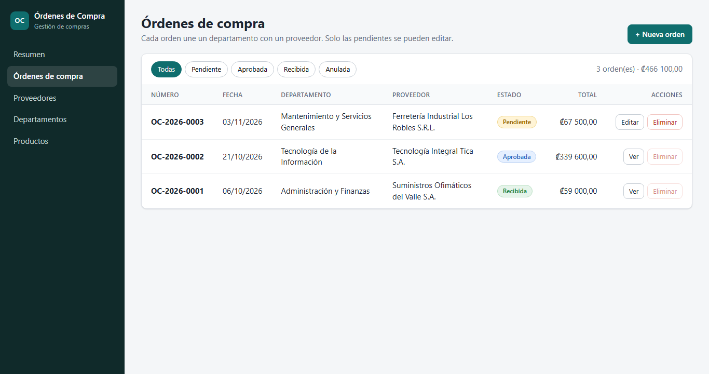
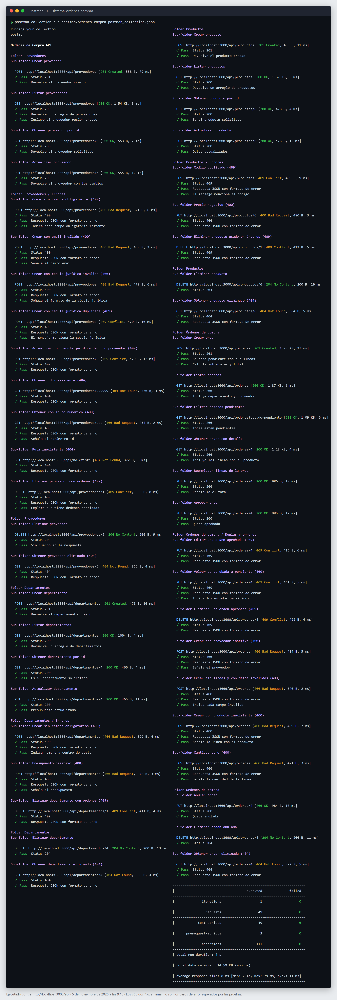
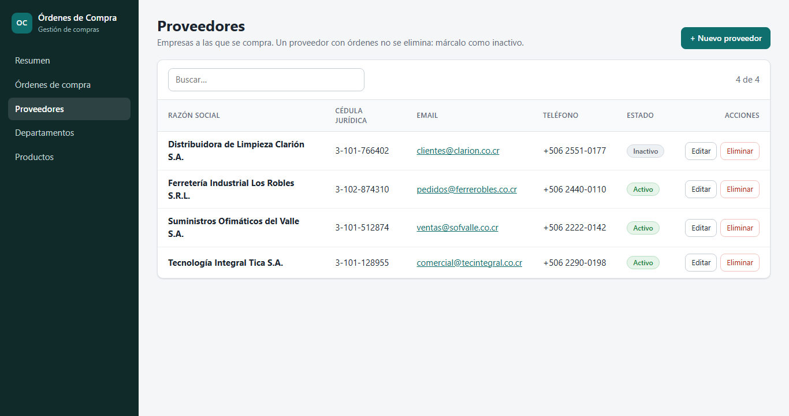

# Órdenes de Compra

Sistema para centralizar las órdenes de compra de una empresa: departamentos solicitantes, proveedores, catálogo de productos y el estado de cada pedido, con control del gasto por departamento.

- **API REST** en Node.js + Express, con MySQL y Sequelize.
- **Aplicación web** en React + Vite que consume la API.



## Funcionalidades

- **Resumen:** órdenes pendientes de aprobación, órdenes aprobadas por recibir, gasto comprometido y uso del presupuesto de cada departamento.
- **Órdenes de compra:** alta con varias líneas de productos, cálculo automático de subtotales y total, filtro por estado y ciclo de aprobación.
- **Proveedores, departamentos y productos:** CRUD completo con búsqueda, formularios de alta y edición, y eliminación con confirmación.
- **Validaciones** en el back end, con mensajes de error que la interfaz muestra junto a cada campo.

### Reglas de negocio

| Regla | Respuesta de la API |
|---|---|
| Una orden nueva siempre inicia como `pendiente` y su total lo calcula el servidor | — |
| Si una línea no trae precio, se usa el precio de referencia del producto | — |
| Ciclo de estados: `pendiente → aprobada → recibida`; `pendiente` o `aprobada → anulada` | 409 si el cambio no está permitido |
| Solo una orden pendiente se puede editar (número, fecha, departamento, proveedor, líneas) | 409 |
| Solo se eliminan órdenes pendientes o anuladas; sus líneas se borran en cascada | 409 |
| Un proveedor inactivo no puede recibir órdenes nuevas | 400 |
| No se elimina un departamento, proveedor o producto que ya forma parte de una orden | 409 |
| La cédula jurídica del proveedor debe tener el formato `3-101-123456` | 400 |
| Cédula jurídica del proveedor, código del producto y número de orden son únicos | 409 |

## Requisitos

- Node.js 18 o superior (probado con Node 24)
- MySQL 8.0
- Postman CLI (opcional, para ejecutar las pruebas automatizadas)

## Estructura

```
├── backend/                API REST (Express + Sequelize)
│   ├── src/
│   │   ├── config/           Conexión a la base de datos
│   │   ├── models/           Modelos y relaciones
│   │   ├── controllers/      Lógica de cada recurso
│   │   ├── routes/           Rutas, montadas bajo /api
│   │   ├── middlewares/      Validación, 404 y manejo de errores
│   │   ├── validators/       Reglas de express-validator
│   │   └── seeders/          Datos de ejemplo
│   └── server.js
├── frontend/               Aplicación React (Vite)
│   └── src/
│       ├── components/       Formularios, tablas, modales y avisos
│       ├── pages/            Una vista por entidad y el resumen
│       ├── hooks/            Carga de listados y estado de formularios
│       ├── services/         Llamadas a la API
│       └── utils/            Formato de montos y fechas
├── docs/                   Justificación, diagrama ER y evidencias
└── postman/                Colección de pruebas
```

## Puesta en marcha

### 1. Crear la base de datos

```sql
CREATE DATABASE ordenes_compra CHARACTER SET utf8mb4 COLLATE utf8mb4_unicode_ci;
```

Las tablas no se crean a mano: el servidor las genera con `sequelize.sync()` al arrancar.

### 2. Configurar el back end

```bash
cd backend
cp .env.example .env      # en Windows: copy .env.example .env
```

Edita `backend/.env` con tus datos:

| Variable | Descripción | Ejemplo |
|---|---|---|
| `PORT` | Puerto de la API | `3000` |
| `CORS_ORIGIN` | Origen permitido para el front | `http://localhost:5173` |
| `DB_HOST` | Servidor MySQL | `localhost` |
| `DB_PORT` | Puerto MySQL | `3306` |
| `DB_NAME` | Nombre de la base de datos | `ordenes_compra` |
| `DB_USER` | Usuario MySQL | `root` |
| `DB_PASSWORD` | Contraseña MySQL | |

### 3. Instalar dependencias y cargar datos de ejemplo

```bash
npm install
npm run seed
```

El seed **recrea las tablas** y carga 3 departamentos, 4 proveedores, 5 productos y 3 órdenes de compra (una pendiente, una aprobada y una recibida). No lo ejecutes sobre una base con datos que quieras conservar.

### 4. Levantar la API

```bash
npm run dev     # desarrollo, con recarga automática (nodemon)
npm start       # producción
```

La API queda disponible en `http://localhost:3000/api`.

### 5. Levantar el front end

```bash
cd ../frontend
npm install
npm run dev
```

Abre `http://localhost:5173`. La URL de la API se configura con `VITE_API_URL` (ver `frontend/.env.example`).

## API

Todas las rutas cuelgan de `/api` y responden JSON. Cada recurso tiene las cinco operaciones REST:

| Método | Ruta | Respuesta |
|---|---|---|
| `GET` | `/api/{recurso}` | 200 con el listado |
| `GET` | `/api/{recurso}/:id` | 200, o 404 si no existe |
| `POST` | `/api/{recurso}` | 201 con el registro creado |
| `PUT` | `/api/{recurso}/:id` | 200 con el registro actualizado (se envían solo los campos que cambian) |
| `DELETE` | `/api/{recurso}/:id` | 204; 409 si el registro está en uso |

| Recurso | Campos (`*` obligatorio al crear) |
|---|---|
| `departamentos` | `nombre*`, `centro_costo*`, `presupuesto` |
| `proveedores` | `razon_social*`, `cedula_juridica*` (única, formato `3-101-123456`), `email*`, `telefono`, `activo` (por defecto `true`) |
| `productos` | `codigo*` (único), `nombre*`, `unidad*`, `precio_ref` |
| `ordenes` | `numero*` (único), `fecha*` (AAAA-MM-DD), `departamento_id*`, `proveedor_id*`, `detalles*`, `estado` (solo al actualizar) |

`GET /api/ordenes` acepta los filtros `?estado=`, `?departamento_id=` y `?proveedor_id=`. `GET /api/ordenes/:id` incluye las líneas con su producto.

Ejemplo para crear una orden:

```json
{
  "numero": "OC-2026-0004",
  "fecha": "2026-11-05",
  "departamento_id": 1,
  "proveedor_id": 2,
  "detalles": [
    { "producto_id": 2, "cantidad": 2 },
    { "producto_id": 3, "cantidad": 3, "precio_unitario": 15000 }
  ]
}
```

Los montos (`presupuesto`, `precio_ref`, `precio_unitario`, `subtotal`, `total`) están en colones costarricenses (₡) con dos decimales.

Para cambiar el estado se envía solo `{ "estado": "aprobada" }`. Si se envía `detalles` en un `PUT`, las líneas de la orden se reemplazan y el total se recalcula.

### Errores

Todas las respuestas de error tienen la misma forma:

```json
{
  "error": "Datos de entrada no válidos",
  "detalles": [
    { "campo": "email", "ubicacion": "body", "mensaje": "El email no tiene un formato válido" }
  ]
}
```

| Código | Cuándo |
|---|---|
| 400 | Faltan campos obligatorios, tipos incorrectos, email o fecha inválidos, id no numérico, referencias inexistentes o JSON mal formado |
| 404 | El registro o la ruta no existen |
| 409 | Valor único repetido, registro en uso o regla de estado de la orden |
| 500 | Error interno |

## Pruebas

La colección `postman/ordenes-compra.postman_collection.json` cubre el CRUD de las cuatro entidades, las reglas de negocio y los casos de error. Con la API levantada y el seed recién cargado:

```bash
postman collection run postman/ordenes-compra.postman_collection.json
```

También puede importarse en la aplicación de Postman. La variable `baseUrl` apunta a `http://localhost:3000/api`.

Resultado de la última ejecución (48 peticiones, 108 aserciones, 0 fallos):



La salida completa en texto está en [`docs/evidencias/pruebas-postman.txt`](docs/evidencias/pruebas-postman.txt).

## Capturas

| Resumen | Proveedores |
|---|---|
|  |  |

## Documentación

- [Justificación del sistema](docs/justificacion.md)
- [Diagrama entidad-relación](docs/diagrama-er.md)
- [Justificación y modelo de datos (PDF)](docs/Ordenes_de_Compra_Justificacion_y_Modelo.pdf)
- [Evidencia de pruebas con Postman](docs/evidencias/pruebas-postman.png)
