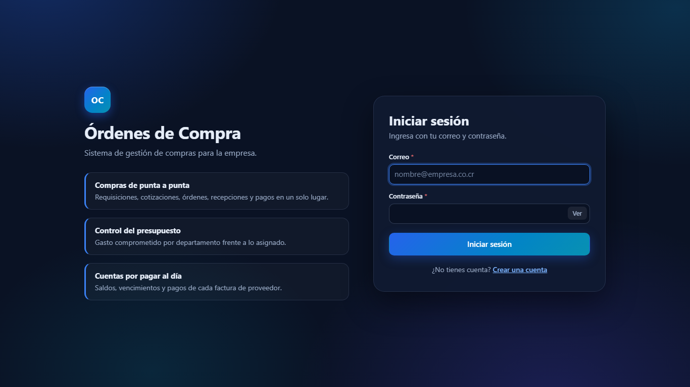
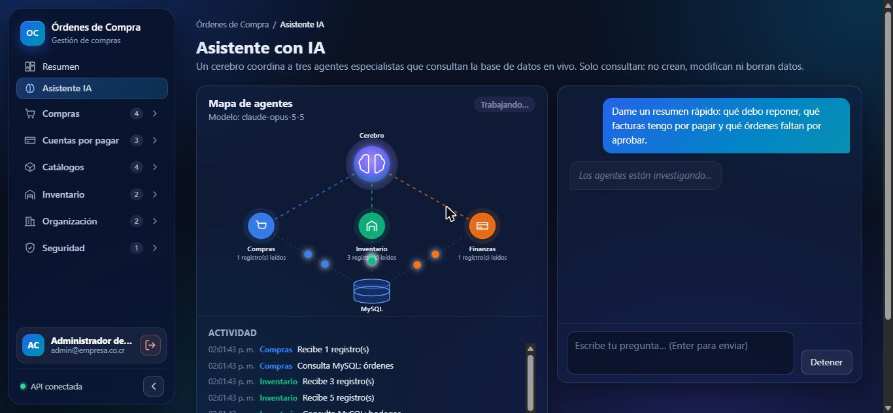
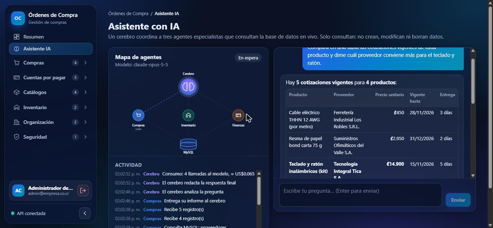
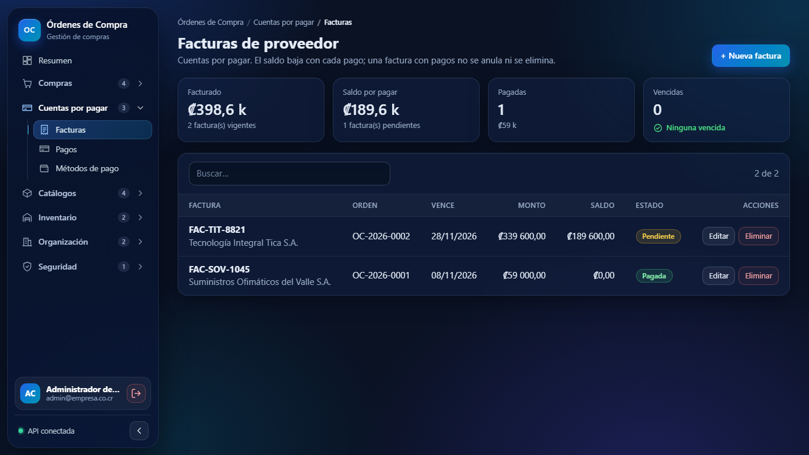
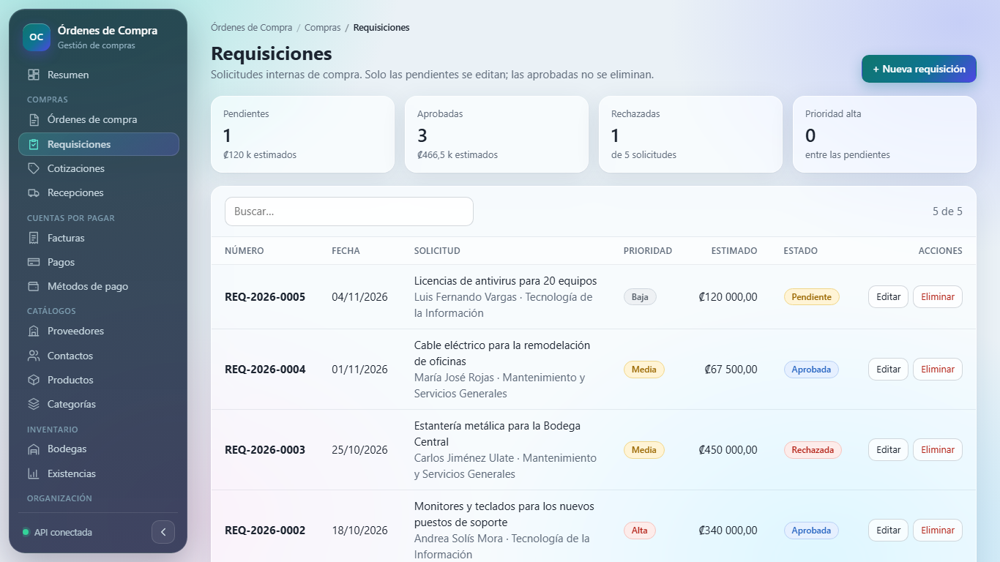
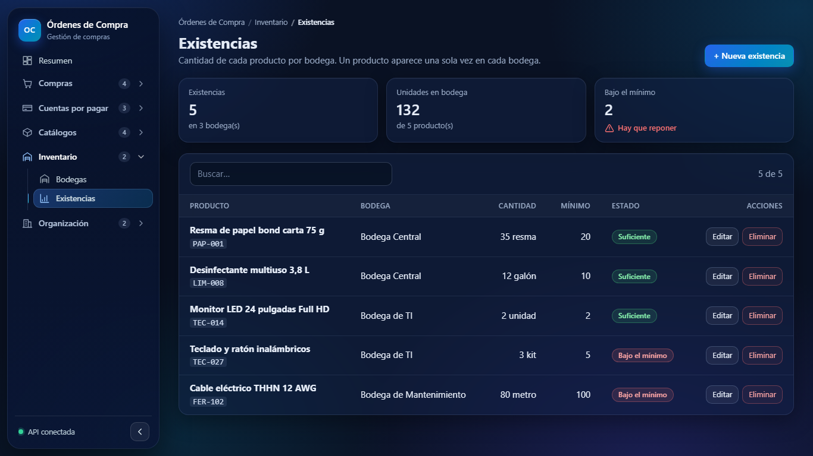
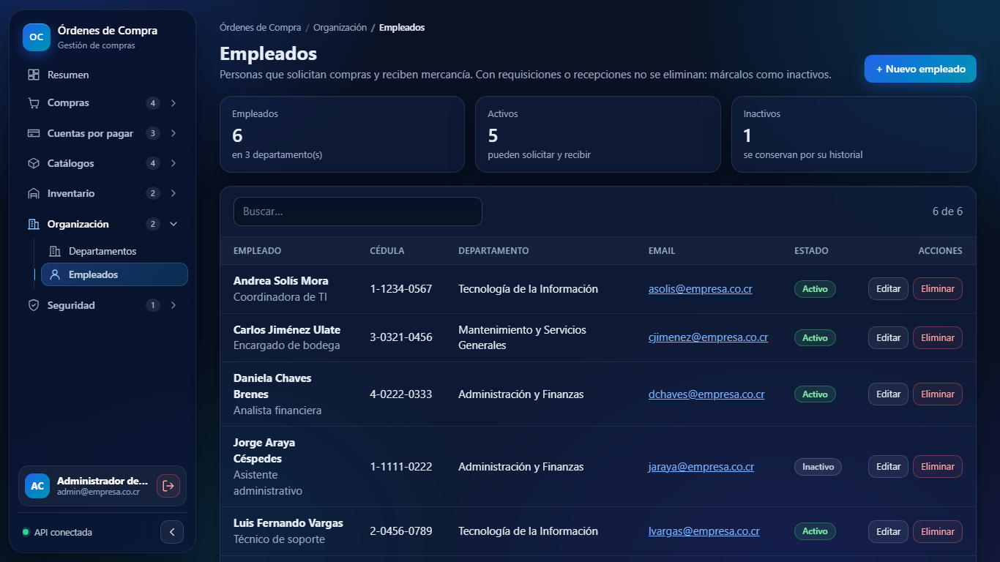

# Órdenes de Compra

Sistema para centralizar el ciclo de compras de una empresa: requisiciones, cotizaciones, órdenes de compra, recepción en bodegas, facturas de proveedor y pagos, con control del gasto por departamento.

**16 CRUDs completos (incluido Usuarios) · 17 tablas · 86 endpoints REST · autenticación con JWT · asistente multiagente con IA · 20 pantallas en React.**

- **API REST** en Node.js + Express, con MySQL y Sequelize.
- **Aplicación web** en React + Vite que consume la API.


## Funcionalidades

- **Resumen (dashboard):** gasto comprometido frente al presupuesto, 6 indicadores (cuentas por pagar, órdenes por aprobar, requisiciones, productos bajo el mínimo, pagos del mes, proveedores activos), gráficos de gasto por departamento, órdenes por estado, vencimientos de facturas, pagos por mes y compras por proveedor (con tooltip y vista en tabla), y listas de alertas.
- **Métricas en cada pantalla:** los 16 CRUDs muestran sus propios indicadores arriba de la tabla; por ejemplo, Facturas muestra lo facturado, el saldo por pagar y las facturas vencidas.
- **Órdenes de compra:** alta con varias líneas de productos, cálculo automático de subtotales y total, filtro por estado y ciclo de aprobación.
- **16 CRUDs** con búsqueda, formularios de alta y edición, y eliminación con confirmación, agrupados por área:

| Área | CRUDs |
|---|---|
| Compras | Órdenes de compra, Requisiciones, Cotizaciones, Recepciones |
| Cuentas por pagar | Facturas, Pagos, Métodos de pago |
| Catálogos | Proveedores, Contactos de proveedor, Productos, Categorías |
| Inventario | Bodegas, Existencias |
| Organización | Departamentos, Empleados |
| Seguridad | Usuarios |
- **Validaciones** en el back end, con mensajes de error que la interfaz muestra junto a cada campo.

### Reglas de negocio

| Regla | Respuesta de la API |
|---|---|
| Una orden nueva siempre inicia como `pendiente` y su total lo calcula el servidor | — |
| Si una línea no trae precio, se usa el precio de referencia del producto | — |
| Ciclo de estados: `pendiente → aprobada → recibida`; `pendiente` o `aprobada → anulada` | 409 si el cambio no está permitido |
| Solo una orden pendiente se puede editar (número, fecha, departamento, proveedor, líneas) | 409 |
| Solo se eliminan órdenes pendientes o anuladas; sus líneas se borran en cascada | 409 |
| Un proveedor inactivo no puede recibir órdenes nuevas | 400 |
| No se elimina un departamento, proveedor o producto que ya forma parte de una orden | 409 |
| La cédula jurídica del proveedor debe tener el formato `3-101-123456` | 400 |
| Cédula jurídica del proveedor, código del producto y número de orden son únicos | 409 |
| La cédula del empleado debe tener el formato `1-2345-6789` y es única | 400 / 409 |
| Un empleado inactivo no puede crear requisiciones ni recibir mercancía | 400 |
| Solo una requisición pendiente se puede modificar; una aprobada no se elimina | 409 |
| La vigencia de una cotización no puede ser anterior a su fecha; un proveedor inactivo no cotiza | 400 |
| Cada proveedor tiene un solo contacto principal (al marcar uno, los demás dejan de serlo) | — |
| Solo se registran recepciones y facturas de órdenes aprobadas o recibidas | 400 |
| Un producto aparece una sola vez por bodega en existencias | 409 |
| Lo facturado de una orden no puede superar su total; el vencimiento no puede ser anterior a la fecha | 409 / 400 |
| Un pago no puede superar el saldo de la factura; al cubrirlo la factura pasa a `pagada` sola | 409 |
| Una factura con pagos no se anula ni se elimina; una anulada ya no se modifica | 409 |
| No se elimina un registro que otro todavía usa (categoría con productos, bodega con existencias, etc.) | 409 |

## Requisitos

- Node.js 18 o superior (probado con Node 24)
- MySQL 8.0
- Postman CLI (opcional, para ejecutar las pruebas automatizadas)

## Estructura

```
├── backend/                    API REST (Express + Sequelize)
│   ├── .env                    Puerto, conexión a MySQL y JWT_SECRET (no se sube; ver .env.example)
│   ├── src/
│   │   ├── config/               db.js (conexión) y auth.js (clave y duración del token)  [nuevo]
│   │   ├── models/               Una por entidad + Usuario.js  [nuevo]
│   │   ├── controllers/          Un controlador por entidad + authController.js y usuarioController.js  [nuevo]
│   │   ├── routes/               Rutas por entidad + authRoutes.js y usuarioRoutes.js  [nuevo]
│   │   ├── middlewares/          authMiddleware.js (token)  [nuevo], validación, 404 y errores
│   │   ├── validators/           Reglas de express-validator (incluye authValidator.js)
│   │   └── seeders/              Datos de ejemplo y usuario de prueba
│   └── server.js
├── frontend/                   Aplicación React (Vite)
│   └── src/
│       ├── components/           Formularios, tablas, gráficos + RutaProtegida.jsx  [nuevo]
│       ├── context/              AuthContext.jsx: token y usuario actual  [nuevo]
│       ├── pages/                Login.jsx y Registro.jsx  [nuevo] + una vista por entidad y el resumen
│       ├── hooks/                Carga de listados y estado de formularios
│       ├── services/             api.js (envía el token) + un servicio por entidad
│       └── utils/                Formato de montos y fechas
├── docs/                       Justificación, diagrama ER, informe del token y evidencias
├── postman/                    Colección de pruebas
├── database.sql                Esquema de las 17 tablas (referencia; el servidor las crea solo)
└── consultas-mysql.sql         Consultas para revisar los datos en MySQL Workbench
```

## Autenticación (día 2)

- Todas las rutas de los CRUDs exigen `Authorization: Bearer <token>`; sin token válido responden **401 `{ "error": "No autorizado" }`**.
- `POST /api/auth/register` (201, o 400 si el correo existe), `POST /api/auth/login` (200 con `{ token, usuario }`, o 401) y `GET /api/auth/me`.
- Contraseñas cifradas con bcrypt; token JWT HS256 que vence en `JWT_EXPIRES_IN` (8 h).
- Configura `JWT_SECRET` (mínimo 32 caracteres) y `JWT_EXPIRES_IN` en `backend/.env`; ver `backend/.env.example`.
- El seed crea un usuario de prueba; su correo y contraseña están en `backend/src/seeders/seed.js`.
- Informe de la investigación: [docs/informe-token.md](docs/informe-token.md) (también en [PDF](docs/Informe_Token_JWT.pdf)).



## Puesta en marcha

### 1. Crear la base de datos

```sql
CREATE DATABASE ordenes_compra CHARACTER SET utf8mb4 COLLATE utf8mb4_unicode_ci;
```

Las tablas no se crean a mano: el servidor las genera con `sequelize.sync()` al arrancar. Si vienes de una versión anterior del proyecto, ejecuta `npm run seed` para recrearlas con las columnas nuevas.

### 2. Configurar el back end

```bash
cd backend
cp .env.example .env      # en Windows: copy .env.example .env
```

Edita `backend/.env` con tus datos:

| Variable | Descripción | Ejemplo |
|---|---|---|
| `PORT` | Puerto de la API | `3000` |
| `CORS_ORIGIN` | Origen permitido para el front | `http://localhost:5173` |
| `DB_HOST` | Servidor MySQL | `localhost` |
| `DB_PORT` | Puerto MySQL | `3306` |
| `DB_NAME` | Nombre de la base de datos | `ordenes_compra` |
| `DB_USER` | Usuario MySQL | `root` |
| `DB_PASSWORD` | Contraseña MySQL | |
| `JWT_SECRET` | Clave para firmar los tokens (mínimo 32 caracteres aleatorios). Genérala con `node -e "console.log(require('crypto').randomBytes(48).toString('hex'))"` | |
| `JWT_EXPIRES_IN` | Duración del token | `8h` |
| `ANTHROPIC_API_KEY` | Clave de la API de Anthropic para el asistente (opcional) | |
| `ASISTENTE_MODELO` | Modelo del asistente | `claude-opus-5-5` |
| `LIMITE_ASISTENTE` | Preguntas por minuto por usuario | `10` |
| `LIMITE_LOGIN` | Intentos de login cada 15 minutos por IP | `30` |

### 3. Instalar dependencias y cargar datos de ejemplo

```bash
npm install
npm run seed
```

El seed **recrea las 17 tablas** y carga datos de ejemplo en todas: departamentos, empleados, proveedores con sus contactos, categorías, productos, requisiciones, cotizaciones, 3 órdenes de compra (una pendiente, una aprobada y una recibida), bodegas, existencias, recepciones, facturas, pagos, métodos de pago y un usuario de prueba para iniciar sesión (correo y contraseña en `backend/src/seeders/seed.js`). Las cuentas que hayas creado con "Crear una cuenta" se conservan al volver a ejecutar el seed. No lo ejecutes sobre una base con datos que quieras conservar.

### 4. Levantar la API

```bash
npm run dev     # desarrollo, con recarga automática (nodemon)
npm start       # producción
```

La API queda disponible en `http://localhost:3000/api`.

### 5. Levantar el front end

```bash
cd ../frontend
npm install
npm run dev
```

Abre `http://localhost:5173`. La URL de la API se configura con `VITE_API_URL` (ver `frontend/.env.example`).

## Asistente con IA (cerebro + agentes)

La pantalla **Asistente IA** responde preguntas en lenguaje natural sobre los datos del sistema usando **Claude** (modelo `claude-opus-5-5` de Anthropic) con una arquitectura multiagente:

```
                 ┌──────────────┐
   pregunta ───▶ │   Cerebro    │ ───▶ respuesta final
                 └──────┬───────┘
          delega (en paralelo si la pregunta abarca varias áreas)
        ┌───────────────┼───────────────┐
 ┌──────▼──────┐ ┌──────▼──────┐ ┌──────▼──────┐
 │   Compras   │ │ Inventario  │ │  Finanzas   │
 └──────┬──────┘ └──────┬──────┘ └──────┬──────┘
        └───── consultas de solo lectura ┘
                        ▼
                     MySQL
```

- **Cerebro** (`backend/src/asistente/agentes.js`): recibe la pregunta, decide a qué agentes delegarla y combina sus informes. No toca la base de datos.
- **Agentes especialistas**: cada uno tiene sus propias herramientas de consulta (`backend/src/asistente/datos.js`):
  - **Compras:** órdenes, requisiciones, cotizaciones y proveedores.
  - **Inventario:** existencias bajo el mínimo, bodegas y recepciones.
  - **Finanzas:** facturas y saldos, pagos y gasto frente al presupuesto.
- **En vivo:** `POST /api/asistente` transmite cada paso (el cerebro piensa, delega, el agente consulta MySQL, entrega su informe) y la pantalla los muestra en un **mapa animado**: los agentes se desplazan hacia la base de datos al consultar y hacia el cerebro al entregar su informe, con un registro de actividad.

**Seguridad:** las herramientas son de **solo lectura** (los agentes no pueden crear, modificar ni borrar datos); las rutas exigen token; la pregunta y el historial se validan; y las instrucciones de los agentes indican tratar los datos de la base como información, no como órdenes. Está activado el respaldo automático de la API (`fallbacks: "default"`): si el modelo declina una consulta por sus filtros de seguridad, la API la reintenta con otro modelo.

**Configuración:**

1. Crea una clave en [platform.claude.com](https://platform.claude.com) (*Settings → API keys*).
2. Agrégala en `backend/.env`: `ANTHROPIC_API_KEY=tu_clave` (opcional: `ASISTENTE_MODELO`, por defecto `claude-opus-5-5`).
3. Reinicia el back end. Sin clave, el resto del sistema funciona igual y la pantalla explica cómo configurarlo.

**Costo:** cada pregunta hace entre 3 y 10 llamadas al modelo (el cerebro más los agentes que consulte). En las pruebas reales, una pregunta que consultó a los 3 agentes costó unos **US$0.08** (8 llamadas) y una que consultó a uno, unos US$0.07. Para controlarlo:

- Cada respuesta muestra en pantalla las llamadas, los tokens y el **costo estimado**.
- Hay un **límite de 10 preguntas por minuto por usuario** (429 si se supera; se configura con `LIMITE_ASISTENTE`).
- Los agentes usan esfuerzo bajo y el cerebro esfuerzo medio.

El diseño, las decisiones y las pruebas se explican en [docs/asistente-ia.md](docs/asistente-ia.md) (también en [PDF](docs/Asistente_IA.pdf)).

| Agentes trabajando (datos llegando desde MySQL) | Respuesta con tabla y consumo |
|---|---|
|  |  |

## Ver los datos en vivo en MySQL

La aplicación guarda todo directamente en MySQL: lo que creas, editas o eliminas en la interfaz queda en la base al instante.

1. Abre **MySQL Workbench** y conéctate al mismo servidor del `.env` (`localhost:3306`, usuario `root`).
2. En el panel **Schemas** abre la base **`ordenes_compra`** (la del `DB_NAME` del `.env`). Si no la ves, haz clic en el botón de actualizar del panel.
3. Abre `consultas-mysql.sql` (*File → Open SQL Script*) y ejecuta la consulta que quieras con **Ctrl + Enter**, o haz clic derecho en una tabla y elige *Select Rows*.
4. Haz un cambio en la aplicación (por ejemplo, crea un proveedor) y **vuelve a ejecutar la consulta**: el registro nuevo aparece. Workbench no refresca solo los resultados; hay que ejecutar la consulta otra vez.

Las contraseñas de `usuarios` se ven como un hash de bcrypt (empiezan con `$2b$`), nunca en texto plano.

## API

Todas las rutas cuelgan de `/api` y responden JSON. Cada recurso tiene las cinco operaciones REST:

| Método | Ruta | Respuesta |
|---|---|---|
| `GET` | `/api/{recurso}` | 200 con el listado |
| `GET` | `/api/{recurso}/:id` | 200, o 404 si no existe |
| `POST` | `/api/{recurso}` | 201 con el registro creado |
| `PUT` | `/api/{recurso}/:id` | 200 con el registro actualizado (se envían solo los campos que cambian) |
| `DELETE` | `/api/{recurso}/:id` | 204; 409 si el registro está en uso |

| Recurso | Campos (`*` obligatorio al crear) | Filtros del listado |
|---|---|---|
| `departamentos` | `nombre*`, `centro_costo*`, `presupuesto` | — |
| `empleados` | `cedula*` (única, `1-2345-6789`), `nombre*`, `puesto*`, `email*`, `departamento_id*`, `telefono`, `activo` | `departamento_id` |
| `proveedores` | `razon_social*`, `cedula_juridica*` (única, `3-101-123456`), `email*`, `telefono`, `activo` | — |
| `contactos-proveedor` | `proveedor_id*`, `nombre*`, `email*`, `puesto`, `telefono`, `principal` | `proveedor_id` |
| `categorias` | `nombre*` (único), `descripcion` | — |
| `productos` | `codigo*` (único), `nombre*`, `unidad*`, `precio_ref`, `categoria_id` | `categoria_id` |
| `requisiciones` | `numero*` (único), `fecha*`, `empleado_id*`, `descripcion*`, `prioridad`, `monto_estimado`, `estado` (al actualizar) | `estado`, `empleado_id` |
| `cotizaciones` | `proveedor_id*`, `producto_id*`, `fecha*`, `vigencia_hasta*`, `precio*`, `dias_entrega`, `observaciones` | `proveedor_id`, `producto_id` |
| `ordenes` | `numero*` (único), `fecha*`, `departamento_id*`, `proveedor_id*`, `detalles*`, `estado` (al actualizar) | `estado`, `departamento_id`, `proveedor_id` |
| `recepciones` | `orden_id*`, `bodega_id*`, `empleado_id*`, `fecha*`, `observaciones` | `orden_id`, `bodega_id` |
| `bodegas` | `nombre*` (único), `ubicacion*`, `responsable_id`, `activa` | — |
| `existencias` | `producto_id*`, `bodega_id*`, `cantidad*`, `minimo` | `producto_id`, `bodega_id` |
| `facturas` | `numero*` (único), `orden_id*`, `fecha*`, `fecha_vencimiento*`, `monto*`, `estado` (al actualizar: `pendiente` o `anulada`) | `estado`, `orden_id` |
| `pagos` | `factura_id*`, `metodo_pago_id*`, `fecha*`, `monto*`, `referencia` | `factura_id`, `metodo_pago_id` |
| `metodos-pago` | `nombre*` (único), `descripcion`, `activo` | — |
| `usuarios` | `nombre*`, `correo*` (único; repetido → 400), `password*` (mínimo 8, se cifra; al actualizar es opcional). Nunca se devuelve la contraseña; no se puede eliminar la cuenta propia (409) | — |

Las fechas van en formato `AAAA-MM-DD`. Las respuestas incluyen los datos básicos de los registros relacionados (por ejemplo, un empleado trae su `departamento`). `GET /api/ordenes/:id` incluye las líneas con su producto. Además de los 80 endpoints de los 16 CRUDs (todos requieren token), están los 3 de autenticación, los 2 del asistente con IA y `GET /api`, público, que indica si el servicio está activo.

Ejemplo para crear una orden:

```json
{
  "numero": "OC-2026-0004",
  "fecha": "2026-11-05",
  "departamento_id": 1,
  "proveedor_id": 2,
  "detalles": [
    { "producto_id": 2, "cantidad": 2 },
    { "producto_id": 3, "cantidad": 3, "precio_unitario": 15000 }
  ]
}
```

Todos los montos están en colones costarricenses (₡) con dos decimales.

Para cambiar el estado se envía solo `{ "estado": "aprobada" }`. Si se envía `detalles` en un `PUT`, las líneas de la orden se reemplazan y el total se recalcula.

### Errores

Todas las respuestas de error tienen la misma forma:

```json
{
  "error": "Datos de entrada no válidos",
  "detalles": [
    { "campo": "email", "ubicacion": "body", "mensaje": "El email no tiene un formato válido" }
  ]
}
```

| Código | Cuándo |
|---|---|
| 400 | Faltan campos obligatorios, tipos incorrectos, email o fecha inválidos, id no numérico, referencias inexistentes o JSON mal formado |
| 404 | El registro o la ruta no existen |
| 409 | Valor único repetido, registro en uso o regla de estado de la orden |
| 500 | Error interno |

## Pruebas

### Pruebas automáticas del asistente

```bash
cd backend
npm test
```

8 pruebas del cerebro y los agentes con un cliente simulado: no llaman a la API de Anthropic, no necesitan clave y no gastan dinero. Sí leen MySQL, así que requieren la base encendida y el seed cargado. Verifican la delegación en paralelo, que cada agente reciba solo sus herramientas, el cálculo del consumo, que la base de datos no cambie, el manejo de errores y rechazos del modelo, el tope de pasos y el límite de uso.

### Colección de Postman

La colección `postman/ordenes-compra.postman_collection.json` cubre la autenticación (registro, login, perfil y los casos 401), los 16 CRUDs (incluido Usuarios), las reglas de negocio y los casos de error. La carpeta **Autenticación** va primero: registra un usuario nuevo, inicia sesión y guarda el token, que el resto de la colección usa automáticamente. Las pruebas crean sus propios registros y los eliminan al final, así que se pueden repetir. Con la API levantada y el seed recién cargado:

```bash
postman collection run postman/ordenes-compra.postman_collection.json
```

También puede importarse en la aplicación de Postman. La variable `baseUrl` apunta a `http://localhost:3000/api`.

Resultado de la última ejecución (204 peticiones, 480 aserciones, 0 fallos):


La salida completa en texto está en [`docs/evidencias/pruebas-postman.txt`](docs/evidencias/pruebas-postman.txt).

## Capturas

| Resumen | Proveedores |
|---|---|
|  |  |
| **Facturas** | **Requisiciones** |
|  |  |
| **Existencias** | **Empleados** |
|  |  |

## Documentación

- [Justificación del sistema](docs/justificacion.md)
- [Diagrama entidad-relación](docs/diagrama-er.md)
- [Justificación y modelo de datos (PDF)](docs/Ordenes_de_Compra_Justificacion_y_Modelo.pdf)
- [Informe de investigación sobre el token JWT](docs/informe-token.md) ([PDF](docs/Informe_Token_JWT.pdf))
- [Asistente con IA: arquitectura, decisiones y pruebas](docs/asistente-ia.md) ([PDF](docs/Asistente_IA.pdf))
- [Evidencia de pruebas con Postman](docs/evidencias/pruebas-postman.png)
