# Diagrama entidad-relación

El sistema tiene **16 tablas**: 15 con CRUD propio y `DETALLES_ORDEN`, que se gestiona junto con su orden de compra.

```mermaid
erDiagram
    DEPARTAMENTOS   ||--o{ EMPLEADOS            : "tiene"
    DEPARTAMENTOS   ||--o{ ORDENES_COMPRA       : "solicita"
    PROVEEDORES     ||--o{ ORDENES_COMPRA       : "atiende"
    PROVEEDORES     ||--o{ CONTACTOS_PROVEEDOR  : "tiene"
    PROVEEDORES     ||--o{ COTIZACIONES         : "ofrece"
    CATEGORIAS      |o--o{ PRODUCTOS            : "agrupa"
    PRODUCTOS       ||--o{ DETALLES_ORDEN       : "se pide en"
    PRODUCTOS       ||--o{ COTIZACIONES         : "se cotiza en"
    PRODUCTOS       ||--o{ EXISTENCIAS          : "se almacena en"
    ORDENES_COMPRA  ||--|{ DETALLES_ORDEN       : "contiene"
    ORDENES_COMPRA  ||--o{ RECEPCIONES          : "se recibe en"
    ORDENES_COMPRA  ||--o{ FACTURAS             : "se factura en"
    EMPLEADOS       ||--o{ REQUISICIONES        : "solicita"
    EMPLEADOS       ||--o{ RECEPCIONES          : "recibe"
    EMPLEADOS       |o--o{ BODEGAS              : "es responsable de"
    BODEGAS         ||--o{ EXISTENCIAS          : "guarda"
    BODEGAS         ||--o{ RECEPCIONES          : "recibe en"
    FACTURAS        ||--o{ PAGOS                : "se paga con"
    METODOS_PAGO    ||--o{ PAGOS                : "se usa en"

    DEPARTAMENTOS {
        INT id PK
        VARCHAR(100) nombre "NOT NULL"
        VARCHAR(20) centro_costo "NOT NULL"
        DECIMAL(12_2) presupuesto
    }

    EMPLEADOS {
        INT id PK
        VARCHAR(12) cedula UK "NOT NULL, formato 1-2345-6789"
        VARCHAR(120) nombre "NOT NULL"
        VARCHAR(80) puesto "NOT NULL"
        VARCHAR(120) email "NOT NULL"
        VARCHAR(30) telefono
        BOOLEAN activo "DEFAULT true"
        INT departamento_id FK "ON DELETE RESTRICT"
    }

    PROVEEDORES {
        INT id PK
        VARCHAR(150) razon_social "NOT NULL"
        VARCHAR(20) cedula_juridica UK "NOT NULL, formato 3-101-123456"
        VARCHAR(120) email "NOT NULL"
        VARCHAR(30) telefono
        BOOLEAN activo "DEFAULT true"
    }

    CONTACTOS_PROVEEDOR {
        INT id PK
        VARCHAR(120) nombre "NOT NULL"
        VARCHAR(80) puesto
        VARCHAR(120) email "NOT NULL"
        VARCHAR(30) telefono
        BOOLEAN principal "DEFAULT false"
        INT proveedor_id FK "ON DELETE CASCADE"
    }

    CATEGORIAS {
        INT id PK
        VARCHAR(80) nombre UK "NOT NULL"
        VARCHAR(255) descripcion
    }

    PRODUCTOS {
        INT id PK
        VARCHAR(30) codigo UK "NOT NULL"
        VARCHAR(150) nombre "NOT NULL"
        VARCHAR(20) unidad "NOT NULL"
        DECIMAL(12_2) precio_ref ">= 0"
        INT categoria_id FK "NULL, ON DELETE RESTRICT"
    }

    REQUISICIONES {
        INT id PK
        VARCHAR(30) numero UK "NOT NULL"
        DATE fecha "NOT NULL"
        VARCHAR(255) descripcion "NOT NULL"
        ENUM prioridad "baja | media | alta"
        DECIMAL(12_2) monto_estimado
        ENUM estado "pendiente | aprobada | rechazada"
        INT empleado_id FK "ON DELETE RESTRICT"
    }

    COTIZACIONES {
        INT id PK
        DATE fecha "NOT NULL"
        DATE vigencia_hasta "NOT NULL, >= fecha"
        DECIMAL(12_2) precio "NOT NULL, >= 0"
        INT dias_entrega
        VARCHAR(255) observaciones
        INT proveedor_id FK "ON DELETE CASCADE"
        INT producto_id FK "ON DELETE RESTRICT"
    }

    ORDENES_COMPRA {
        INT id PK
        VARCHAR(30) numero UK "NOT NULL"
        DATE fecha "NOT NULL"
        ENUM estado "pendiente | aprobada | recibida | anulada"
        DECIMAL(12_2) total "DEFAULT 0"
        INT departamento_id FK "ON DELETE RESTRICT"
        INT proveedor_id FK "ON DELETE RESTRICT"
    }

    DETALLES_ORDEN {
        INT id PK
        INT cantidad "NOT NULL, > 0"
        DECIMAL(12_2) precio_unitario "NOT NULL, >= 0"
        DECIMAL(12_2) subtotal "cantidad x precio_unitario"
        INT orden_id FK "ON DELETE CASCADE"
        INT producto_id FK "ON DELETE RESTRICT"
    }

    RECEPCIONES {
        INT id PK
        DATE fecha "NOT NULL"
        VARCHAR(255) observaciones
        INT orden_id FK "ON DELETE RESTRICT"
        INT bodega_id FK "ON DELETE RESTRICT"
        INT empleado_id FK "ON DELETE RESTRICT"
    }

    BODEGAS {
        INT id PK
        VARCHAR(80) nombre UK "NOT NULL"
        VARCHAR(200) ubicacion "NOT NULL"
        BOOLEAN activa "DEFAULT true"
        INT responsable_id FK "NULL, ON DELETE SET NULL"
    }

    EXISTENCIAS {
        INT id PK
        INT cantidad "NOT NULL, >= 0"
        INT minimo "NOT NULL, >= 0"
        INT producto_id FK "UK con bodega_id"
        INT bodega_id FK "UK con producto_id"
    }

    FACTURAS {
        INT id PK
        VARCHAR(30) numero UK "NOT NULL"
        DATE fecha "NOT NULL"
        DATE fecha_vencimiento "NOT NULL, >= fecha"
        DECIMAL(12_2) monto "NOT NULL, > 0"
        DECIMAL(12_2) pagado "lo calcula el servidor"
        ENUM estado "pendiente | pagada | anulada"
        INT orden_id FK "ON DELETE RESTRICT"
    }

    PAGOS {
        INT id PK
        DATE fecha "NOT NULL"
        DECIMAL(12_2) monto "NOT NULL, > 0"
        VARCHAR(60) referencia
        INT factura_id FK "ON DELETE RESTRICT"
        INT metodo_pago_id FK "ON DELETE RESTRICT"
    }

    METODOS_PAGO {
        INT id PK
        VARCHAR(60) nombre UK "NOT NULL"
        VARCHAR(255) descripcion
        BOOLEAN activo "DEFAULT true"
    }
```

Todas las tablas incluyen además `created_at` y `updated_at`.

## Reglas de las relaciones

| Relación | Cardinalidad | Al eliminar el padre |
|---|---|---|
| Departamento → Empleado | 1 : N | RESTRICT: no se elimina un departamento con empleados |
| Departamento → OrdenCompra | 1 : N | RESTRICT: no se elimina un departamento con órdenes |
| Proveedor → OrdenCompra | 1 : N | RESTRICT: no se elimina un proveedor con órdenes |
| Proveedor → ContactoProveedor | 1 : N | CASCADE: se eliminan sus contactos |
| Proveedor → Cotización | 1 : N | CASCADE: se eliminan sus cotizaciones |
| Categoría → Producto | 1 : N (opcional) | RESTRICT: no se elimina una categoría con productos |
| Producto → DetalleOrden / Cotización / Existencia | 1 : N | RESTRICT: no se elimina un producto en uso |
| OrdenCompra → DetalleOrden | 1 : N | CASCADE: se eliminan sus líneas de detalle |
| OrdenCompra → Recepción / Factura | 1 : N | RESTRICT: no se elimina una orden con recepciones o facturas |
| Empleado → Requisición / Recepción | 1 : N | RESTRICT: no se elimina un empleado con historial |
| Empleado → Bodega (responsable) | 1 : N (opcional) | SET NULL: la bodega queda sin responsable |
| Bodega → Existencia / Recepción | 1 : N | RESTRICT: no se elimina una bodega en uso |
| Factura → Pago | 1 : N | RESTRICT: no se elimina una factura con pagos |
| MétodoPago → Pago | 1 : N | RESTRICT: no se elimina un método con pagos |

> En el diagrama `DECIMAL(12_2)` representa `DECIMAL(12,2)`; Mermaid no admite comas dentro del tipo.
