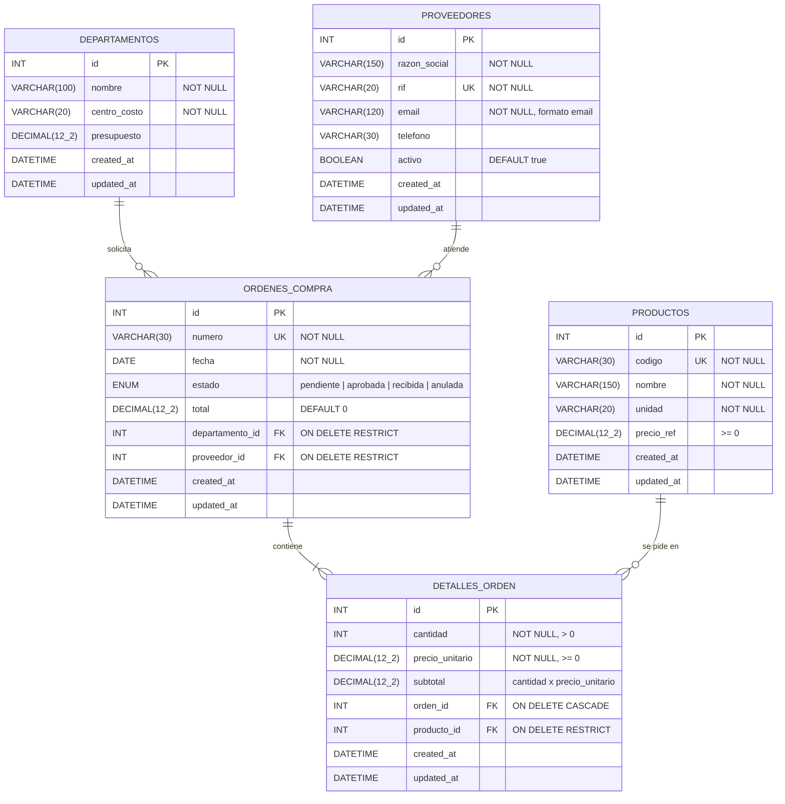

# Diagrama entidad-relación

## Reglas de las relaciones

| Relación | Cardinalidad | Al eliminar el padre |
|---|---|---|
| Departamento → OrdenCompra | 1 : N | RESTRICT: no se elimina un departamento con órdenes |
| Proveedor → OrdenCompra | 1 : N | RESTRICT: no se elimina un proveedor con órdenes |
| OrdenCompra → DetalleOrden | 1 : N | CASCADE: se eliminan sus líneas de detalle |
| Producto → DetalleOrden | 1 : N | RESTRICT: no se elimina un producto usado en órdenes |

> En el diagrama `DECIMAL(12_2)` representa `DECIMAL(12,2)`; Mermaid no admite comas dentro del tipo.
